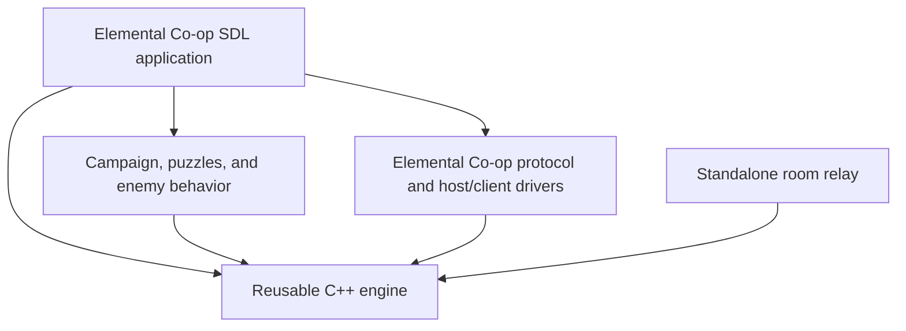

# Engine and application architecture

The SDL application in [`apps/ui_prototype`](../apps/ui_prototype) owns the event loop, screen navigation, campaign progression, and SDL resources. Its campaign adapter maps validated JSON level documents into playable rooms. The [shared game module](../games/elemental_coop/README.md) supplies a smaller headless game and the cooperative network protocol and drivers.

| Subsystem | Responsibility |
| --- | --- |
| World and physics | Entity and component lifetime, body integration, collision masks, contact state, and trigger events |
| Rendering and interaction | Camera and draw commands, SDL rendering, and per-player action buffering |
| Development tools | Versioned level documents, validation, native save/load, Tiled object import, and inspector data |
| Infrastructure | Cached file bytes, settings validation and persistence, and severity-filtered logging |
| Networking | ENet sessions, host-authoritative snapshots, in-memory test transport, and standalone room relay |

The engine's public interfaces are game-independent. The app maps SDL events to per-player actions, advances gameplay using the engine's physics and world, and renders the resulting state. In online play, the host advances the simulation and sends snapshots. The joiner sends input and applies those snapshots.

Coordinates use pixels with positive X right and positive Y down. Durations are in seconds. World lookups borrow component data. File cache handles share immutable bytes, so clearing a cache leaves existing handles valid. The application releases its SDL resources before tearing down the associated renderer or audio device.

See [networking](NETWORKING.md), [rendering](RENDERING.md), and [resource management](RESOURCE_MANAGEMENT.md) for interface details.
