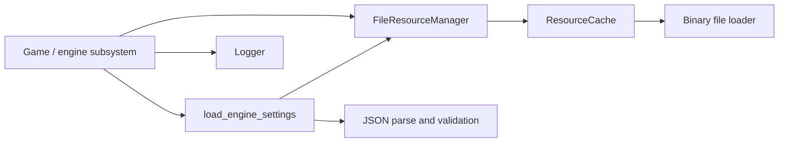

# Arvin — infrastructure implementation guide

This branch provides reusable file resources, cache ownership, logging and validated engine configuration. It is a first implementation deliverable, not completion of every infrastructure stretch goal.

## How the parts connect



**ResourceCache** is the reusable ownership mechanism: it associates a string key with one shared resource. A loader function supplies the actual object, allowing later SDL texture/audio loaders to use the same cache. Failed loads never become cache entries.

**FileResourceManager** makes the cache usable for files. It resolves a relative asset key beneath a known root, normalizes aliases and reads raw bytes. Returned `shared_ptr<const FileResource>` handles share immutable data. `clear()` releases the cache's ownership; consumers retain their data until their own handles go away. This avoids dangling data when one game entity is deleted while another still uses the asset.

**Configuration** interprets JSON as engine settings. Parsing and validation happen in a local value; only a successful result is returned. Assigning that result to active settings prevents a failed reload from changing half the configuration.

**Logger** routes diagnostic text to a caller-owned stream. It supports severity filtering and an optional subsystem label. It does not own the stream or create global mutable state.

## Public files

| Responsibility | Header | Implementation / tests |
|---|---|---|
| Cache and logging | `engine/include/engine/infrastructure.hpp` | `engine/src/infrastructure.cpp`, `tests/infrastructure_test.cpp` |
| Binary file resources | `engine/include/engine/resource_files.hpp` | `engine/src/resource_files.cpp`, `tests/resource_files_test.cpp` |
| Engine configuration | `engine/include/engine/configuration.hpp` | `engine/src/configuration.cpp`, `tests/configuration_test.cpp` |
| Example integration | — | `apps/infrastructure_demo.cpp` |

Detailed file path and lifetime rules are in [resource management](RESOURCE_MANAGEMENT.md).

## Configuration contract

`schema_version` must be integer `1`. Missing window/audio sections or fields use defaults. Provided sections must be objects, and misspelled/unknown fields within these sections are rejected. Other top-level sections, such as `game`, are left to their owners and are not validated by this service.

| Field | Default | Accepted values |
|---|---|---|
| window.width | 960 | Integer 1–16384 |
| window.height | 540 | Integer 1–16384 |
| window.fullscreen | false | Boolean |
| audio.master_volume | 0.8 | Number 0–1 |
| audio.sound_effects | true | Boolean |

The size limits are validation choices, not a guarantee that the platform supports every window size. Review these defaults/limits with Aryaman and Rohan. Unknown top-level data is ignored, not returned; level and game data need separate validation.

```cpp
engine::EngineSettings active;
try {
    active = engine::load_engine_settings(asset_root, "config/elemental_coop.example.json");
} catch (const engine::ConfigurationError& error) {
    logger.write(engine::LogLevel::error, "configuration", error.what());
    // active retains its previous value.
} catch (const engine::ResourceError& error) {
    logger.write(engine::LogLevel::error, "resources", error.what());
}
```

Each `load_engine_settings` call reads fresh bytes. `parse_engine_settings` accepts JSON text directly for unit tests or other file providers. File failures throw `ResourceError`; JSON/schema failures throw `ConfigurationError` with source/field context. The module does not change an SDL window/audio device. The settings persistence branch adds validated file saving; see [Settings persistence](SETTINGS_PERSISTENCE.md) for its API and limitations.

The parser is pinned nlohmann/json 3.12.0, included under `third_party/nlohmann_json` with its MIT license and source hashes. Its include directory is private to the infrastructure target; public engine interfaces do not expose JSON-library types. This dependency choice is recorded for team review; no configure-time download is required.

## Logging contract

```cpp
engine::Logger logger(std::cout, engine::LogLevel::info);
logger.write(engine::LogLevel::debug, "resources", "This is filtered out");
logger.write(engine::LogLevel::error, "resources", "Missing player texture");
// [ERROR][resources] Missing player texture
```

Priority order is debug < info < warning < error. `set_minimum_level` changes the threshold. The existing two-argument `write(level, message)` remains compatible. To log to a file, supply a checked `std::ofstream` that outlives the logger; file rotation, timestamps and thread synchronization are not implemented. Callers log errors at the boundary where they choose recovery, rather than every layer printing the same error.

## Run and understand the tests

From the repository root with CMake on PATH:

```sh
cmake -S . -B build -DCMAKE_BUILD_TYPE=Debug
cmake --build build --config Debug --parallel
ctest --test-dir build -C Debug --output-on-failure
ctest --test-dir build -C Debug -R "^(infrastructure|resource_files|configuration)$" --output-on-failure
./build/infrastructure_demo assets
```

With Visual Studio, run `build/Debug/infrastructure_demo.exe assets` instead. The demo does not require graphics or networking. It shows real file loading, cache reuse, configuration parsing and log output together.

Tests cover multi-chunk binary files and zero bytes, normalized paths, missing-file retry, invalid roots, cleanup after final release, loader exceptions, severity filtering, defaults, invalid JSON/types/ranges, unchanged active settings on failed reload and fresh successful reload. Symlink checks explicitly report skips on platforms that cannot create them.

Verification on November 5, 2026: Apple Clang 15.0.0 / C++20, CMake 4.4.4, all 12 CTest suites passed in both Debug and Release. Both demos ran successfully in Debug. CMake was installed temporarily at `/private/tmp/group2-cmake-tools/cmake/data/bin`; it is not on the permanent PATH. Windows/Linux builds have not been run in this session.

## Team integration still required

- Aryaman + Arvin: decode texture data, choose custom SDL deleters, and release texture handles before their renderer is destroyed.
- Rohan + Arvin: audio loaders and applying/persisting settings through the UI.
- Gunveer + Arvin: use shared file loading and the chosen JSON library while keeping level schemas/import logic in tools.
- Sydney + Arvin: define asset references on components; deleting one entity must not invalidate another entity's shared resource.
- Team: finalize C++ standard and GoogleTest/Catch2 choice. Existing CTest runner remains functional; no framework migration is claimed.

Resource/file services remain main-thread-only. Advanced profiling, background loading, settings-screen integration and real SDL resource integration are subsequent tasks. The current game continues using its existing settings until its owner integrates these services.
